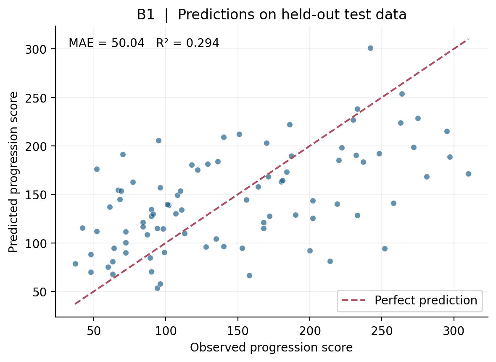
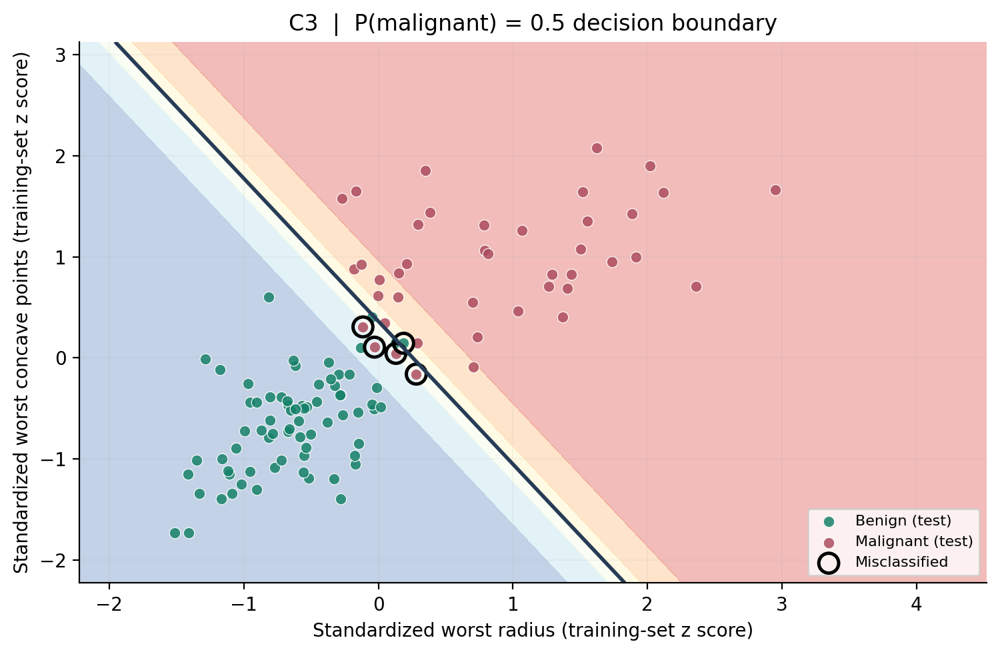

# Biomedical Machine Learning Lab 1

**Understanding Linear and Logistic Regression** · [Biomedical System Design Capsule-S1](https://canvas.agu.edu.tr/courses/374) · Abdullah Gül University

**Student:** Burak Bekir Çakırer  
**Student ID:** 2211011008  
**Submission:** 21 October 2026  
**Language:** Python 3 / English report

## Overview

This repository contains a reproducible, two-dataset investigation of **linear regression** (continuous outcome) and **logistic regression** (binary classification). It covers all experimental sections **A–D** of the *Understanding Linear and Logistic Regression* lab brief. The analysis scripts, exported results, plots, and report are kept separate: **the submitted PDF/Word/LaTeX reports do not contain source code**.

## Datasets and original references

Exactly **two real biomedical datasets** are used, both distributed with scikit-learn. Only two input features from each dataset are modeled so that coefficients and decision boundaries can be interpreted visually.

| Dataset | Task / outcome | Samples | Selected input features | Dataset source |
|---|---|---:|---|---|
| **Diabetes** | Linear regression / continuous one-year progression score | 442 | BMI, average blood pressure | [scikit-learn diabetes](https://scikit-learn.org/stable/modules/generated/sklearn.datasets.load_diabetes.html) |
| **Breast Cancer Wisconsin (Diagnostic)** | Logistic regression / malignant (1) versus benign (0) | 569 | Worst radius, worst concave points | [UCI WDBC](https://archive.ics.uci.edu/dataset/17/breast-cancer-wisconsin-diagnostic) |

**Academic and dataset citations:**

1. Efron, B., Hastie, T., Johnstone, I., & Tibshirani, R. (2004). *Least Angle Regression*. *The Annals of Statistics*, 32(2), 407–499. [doi:10.1214/009053604000000067](https://doi.org/10.1214/009053604000000067). Dataset background for Diabetes.
2. Wolberg, W., Mangasarian, O., Street, N., & Street, W. (1993). *Breast Cancer Wisconsin (Diagnostic)* [Data set]. UCI Machine Learning Repository. [doi:10.24432/C5DW2B](https://doi.org/10.24432/C5DW2B).
3. Street, W. N., Wolberg, W. H., & Mangasarian, O. L. (1993). *Nuclear feature extraction for breast tumor diagnosis*. SPIE 1905, 861–870. [doi:10.1117/12.148698](https://doi.org/10.1117/12.148698).
4. [scikit-learn load_breast_cancer documentation](https://scikit-learn.org/stable/modules/generated/sklearn.datasets.load_breast_cancer.html) (numeric labels in the original loader are **0 = malignant, 1 = benign**; this project recodes them to **1 = malignant, 0 = benign**).

The full bibliography, dataset provenance, and experimental discussion appear in the [report](report/Biomedical_ML_Lab1_Report.pdf). Data are provided by scikit-learn in an offline-loadable bundle; the `results/data/` files are **two-feature exports with recorded train/test membership**, not additional datasets.

## Repository layout

```text
Biomedical_ML_Lab1/
├── README.md
├── .gitignore
├── requirements.txt
├── src/
│   └── run_lab.py               # Reproducible experiments
├── results/
│   ├── data/
│   │   ├── diabetes_two_feature_split.csv
│   │   ├── breast_cancer_two_feature_split.csv
│   │   └── metrics.json         # Detailed numerical results
│   └── figures/                 # Nine generated experiment figures
├── report/
│   ├── Biomedical_ML_Lab1_Report.pdf
│   ├── Biomedical_ML_Lab1_Report.docx
│   ├── main.tex                 # Overleaf-compatible source
│   └── figures/                 # Figures referenced by main.tex
└── docs/
    └── GITHUB_DESKTOP_TR.md     # Windows GitHub Desktop guide
```

## Key experimental results

| Experiment | Summary (held-out test partition unless noted) |
|---|---|
| **B1 — Baseline linear model** | MAE **50.044**, MSE **3740.507**, R² **0.294** |
| **B2 — Standardization** | OLS predictions and test error unchanged to floating-point precision; coefficient units change |
| **B3 — Learning rate** | On standardized training data, η = **0.80** converged fastest among four tested settings; η = **1.50** diverged |
| **C1 — Logistic model, threshold 0.5** | Accuracy **95.61%**, precision **0.974**, recall **0.905**, F1 **0.938** |
| **C2 — Thresholds 0.3 / 0.5 / 0.7** | Malignant recall **1.000 / 0.905 / 0.810**; same fitted model and test probabilities |
| **C3 — One versus two features** | Accuracy improved from **90.35%** to **95.61%** using the second feature |

For interpretations, coefficient tables, the confusion matrix, limitations, and all **nine figures**, see the [PDF report](report/Biomedical_ML_Lab1_Report.pdf).

### Figure previews

**Linear regression — observed versus predicted:**



**Logistic regression — two-feature decision boundary:**



## Run locally (Windows / PowerShell)

1. Install **Python 3.10 or newer** (Python 3.13.5 was used for the supplied results).
2. Put this repository in `D:\GitHub\Biomedical_ML_Lab1` and open PowerShell in that folder.
3. Create a virtual environment and install dependencies:

```powershell
cd D:\GitHub\Biomedical_ML_Lab1
py -m venv .venv
.\.venv\Scripts\Activate.ps1
python -m pip install -r requirements.txt
```

4. Run all experiments:

```powershell
python src\run_lab.py
```

The script writes `results/data/metrics.json`, both annotated data exports and the nine plots under `results/figures/`. A network connection is not required after package installation. For a quick execution without a virtual environment, use `py -m pip install -r requirements.txt` and `py src\run_lab.py`.

> PowerShell script execution may be restricted by your system policy. If activation is blocked, call `.\.venv\Scripts\python.exe src\run_lab.py` instead.

## Experiment settings and reproducibility

- **Splits:** 80% training / 20% untouched test, `random_state=42`; malignant/benign split is stratified.
- **Scaling:** training-only fit; transformations are applied to the held-out test without refitting.
- **Linear model:** ordinary least squares (unscaled and standardized feature comparisons).
- **Convergence:** batch gradient descent, 150 iterations, learning rates 0.01, 0.10, 0.80, 1.50; *training loss* only.
- **Logistic model:** standardized input, L2 regularization, `C=1.0`, `lbfgs` solver, 2000 maximum iterations.
- **Thresholds:** 0.3, 0.5, 0.7 are applied to **the same test probabilities without retraining**.
- **One versus two features:** identical train/test partition and 0.5 threshold.
- **Environment:** Python 3.13.5, NumPy 2.3.5, pandas 2.2.3, scikit-learn 1.8.0, Matplotlib 3.10.8. Dependencies are specified in [requirements.txt](requirements.txt).

## Reports and Overleaf

- **Ready to submit:** [PDF](report/Biomedical_ML_Lab1_Report.pdf)
- **Editable report:** [Word](report/Biomedical_ML_Lab1_Report.docx)
- **LaTeX source:** [main.tex](report/main.tex)

For Overleaf, create a project and upload **both** `report/main.tex` and the entire `report/figures/` directory, preserving their relative paths. Select `main.tex` as the main document and compile with **pdfLaTeX**. These report files contain experimental settings, tables, plots, citations, and analysis **without implementation code**.

## Limitations and research integrity

These are teaching demonstrations, **not clinical decision systems**. Only two of the original 10/30 available predictors are used. The reported scores rely on a single held-out test partition. The illustrative selection of a classification cutoff from the test results is **not a valid model deployment or clinical threshold selection procedure**; this would require independent validation, calibration, and explicit assessment of error costs. Dataset creators and source publications are credited above and in the report.
